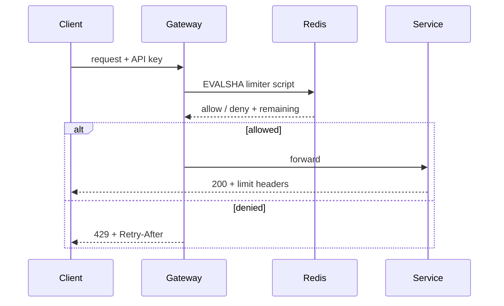

# Design a Rate Limiter

An end-to-end walkthrough of building a distributed [[rate-limiting]] service for a public API. The concepts are covered separately; this note is about the decisions that only appear when you assemble them.

## Requirements

Assume a public API with roughly 50,000 requests per second across 200,000 active API keys, served by a horizontally scaled fleet. Limits are per API key and per endpoint class, since a search endpoint and a health check should not share a budget. Rejections must tell the caller when to retry. The limiter must add no more than a couple of milliseconds at p99, and — the requirement that shapes everything — it must not be able to take the API down on its own.

## Choosing the limit key

Before any algorithm, decide what you are counting.

Keying on API key is the obvious start, but it is not sufficient alone. A single key hitting a cheap endpoint 1,000 times per second is fine; the same key hitting an expensive aggregation endpoint 1,000 times per second is not. So the key becomes a tuple of API key and endpoint class, with a separate global limit per key so that a caller cannot multiply its budget by spreading traffic across every endpoint.

Unauthenticated endpoints — signup, login, password reset — have no API key, so they fall back to IP, with all the weaknesses that implies. This is worth stating explicitly rather than discovering later: IP-keyed limits are a speed bump for abuse, not a defence, because an attacker with a proxy pool simply moves. Their real job is stopping the naive case and buying time for detection.

A useful refinement is weighting: expensive requests consume more than one token. This turns the limiter from a request-rate limiter into a crude cost limiter, which is usually what the business actually wants.

## Choosing the algorithm

[[sliding-window-counter]] for most endpoints. Two integers per key, no boundary doubling, no burst parameter for an operator to misconfigure, and an error rate under a percent that is invisible against limits that were guesses anyway.

[[token-bucket]] for endpoints where legitimate clients are genuinely bursty — bulk ingest, sync-on-foreground mobile traffic — because rejecting a client for doing a normal thing efficiently is worse than absorbing the burst.

[[sliding-window-log]] only on the authentication endpoints, where limits are small (five attempts, not five thousand), exactness is a security property, and the stored timestamps double as an audit trail.

[[fixed-window-counter]] for the monthly billing quota, where the window is long enough that its boundary flaw does not matter and its cheapness does.

Four algorithms sounds like over-engineering, and it would be if each one needed its own service. They share one interface — `allow(key, cost) -> decision` — and differ only in the script the store runs.

## Where the state lives

In-process counters are the fastest possible answer and the wrong one: with 40 instances, a limit of 100 becomes an actual limit of 4,000, and it fluctuates as the fleet autoscales. Sticky routing by API key would fix the arithmetic, but it makes the limiter a constraint on the load balancer and it collapses when the ring changes during a deploy.

So the counters live in [[redis]], keyed by the limit tuple. At 50,000 requests per second this is 50,000 Redis operations per second — comfortable for a single node, though shard by key hash once endpoint-class fan-out multiplies it.

### The atomicity trap

The obvious implementation reads the counter, decides, and writes it back. Under concurrency this is a lost-update race: two instances read 99 against a limit of 100, both conclude there is room, and both write 100. The limit is exceeded and nothing in the code looks wrong.

The fix is to make the whole read-modify-write happen inside the store, as a Lua script that Redis executes atomically:

```
EVALSHA <sha> 1 ratelimit:key42:search 100 60 <now>
```

Every non-trivial algorithm here needs this. Fixed window is the exception, since `INCR` is already atomic and returns the new value — which is a genuine argument in its favour for the quota case.

## Where the check runs



At the [[api-gateway]], because a rejected request should consume as little as possible and because the policy belongs in one place rather than in every service. The cost is that the gateway now needs to know each endpoint's class, which is configuration that drifts from reality unless services declare their own limits and the gateway reads that declaration.

Per-service limiters still have a role as a second layer, protecting a service from internal callers that never pass through the gateway. That is defence in depth, not duplication.

## What the client sees

A rejection is `429 Too Many Requests` with `Retry-After`. Successful responses carry the limit state so a well-behaved client can self-pace instead of discovering the wall by hitting it:

```
X-RateLimit-Limit: 1000
X-RateLimit-Remaining: 847
X-RateLimit-Reset: 1756567890
```

One trap here. If every rejected client is told to retry at the same window reset, they will — and the limiter has just scheduled a synchronised stampede against itself, the [[thundering-herd]] problem that [[fixed-window-counter]] creates structurally. Add jitter to `Retry-After` so clients spread out. This is a two-line change that people leave out and then diagnose for a week.

## When the limiter fails

Redis will be unavailable at some point, and the behaviour then is a policy decision, not an implementation detail.

**Fail open** — allow everything the limiter cannot check — keeps the API serving during a Redis incident, at the cost of removing all protection at the exact moment the system is already unhealthy.

**Fail closed** — reject everything — turns a limiter outage into a full API outage, and is very hard to justify to anyone.

The workable answer is neither. Keep a coarse in-process fallback limiter, sized generously, and switch to it when the store is unreachable: protection degrades from precise to approximate rather than from precise to absent. Wrap the Redis call in a [[circuit-breaker]] so a slow store fails fast instead of adding its latency to every request, and set an aggressive timeout — a limiter that blocks for 500ms has become the outage it existed to prevent.

Security-critical limits are the exception. Login attempt limits should fail closed, because the alternative is that an attacker who can degrade your Redis gets unlimited credential stuffing for free.

## What you give up

The whole design rests on a number nobody can set correctly. Limits are picked from load tests, then never revisited as the cost of a request changes underneath them. A more honest system would derive limits from live health signals — latency, queue depth, error rate — and shed adaptively, which is [[load-shedding]] rather than rate limiting. That is strictly better and considerably harder, and most teams should ship the static limiter first while knowing what it does not do.

You also accept that the limiter is now on the critical path of every request, including all the ones it will allow. Every request pays the Redis round trip so that a small fraction can be rejected. That trade is worth making, but it is worth making deliberately.

## Related

[[rate-limiting]] for the concept and its four framing questions. [[spring-cloud-gateway-rate-limiter]] for what this looks like when the framework has already built it.
