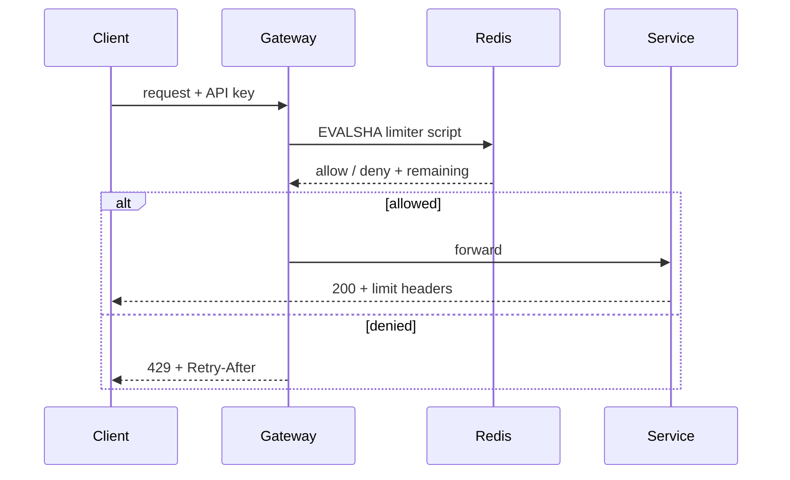

# Design a Rate Limiter

A walkthrough of building a distributed [[rate-limiting]] service for a public API, from the first decision through to the failure modes. The individual algorithms have their own notes. What this one covers is everything that only becomes visible once you try to assemble them into something real.

## What you're building

Picture a public API serving around 50,000 requests per second across 200,000 active API keys, running on a horizontally scaled fleet. Limits apply per API key and per endpoint class, because a search endpoint and a health check have no business sharing a budget. When you reject someone, you owe them an honest answer about when to come back. The limiter should add a millisecond or two at p99, no more.

There's one more requirement, and it quietly constrains every other decision: the limiter must never be able to take the API down by itself. Hold onto that. It's why several of the choices below go the way they do.

## Start with the key, not the algorithm

Most people jump straight to picking an algorithm. Resist that. The first real decision is what you're counting, and it does more to determine whether the limiter works than the algorithm ever will.

Keying on API key is the obvious opening move, and on its own it isn't enough. One key hitting a cheap endpoint a thousand times a second is fine. That same key hitting an expensive aggregation endpoint at the same rate is not. So the key becomes a pair: API key plus endpoint class. You'll want a separate global limit per API key sitting on top of that, or a caller multiplies its budget just by spreading traffic across every endpoint you expose.

Then there are the endpoints with no API key at all. Signup, login, password reset — the ones you most need to protect — have nothing to identify the caller but an IP address. Be honest about this up front rather than discovering it later. IP-keyed limits stop the naive case and buy you time to detect the rest. An attacker with a pool of proxies walks straight through them. That's not an argument against having them, only against believing they're a defence.

One refinement pays for itself. Let expensive requests consume more than one token, and the limiter stops measuring request rate and starts measuring something closer to cost, which is usually what the business meant in the first place.

## Picking algorithms

You'll want more than one, and that's fine.

[[sliding-window-counter]] handles most endpoints. Two integers per key, no boundary doubling, nothing for an operator to misconfigure, and an error rate under a percent that disappears against limits you estimated anyway.

[[token-bucket]] goes on endpoints where real clients are legitimately bursty. Bulk ingest, mobile apps syncing on foreground. Rejecting a client for doing a normal thing efficiently is worse than absorbing the spike.

[[sliding-window-log]] belongs on the auth endpoints and nowhere else. Limits there are small, five attempts rather than five thousand, so its memory cost stays trivial. Exactness becomes a security property when you're counting failed logins, and the stored timestamps double as an audit trail.

[[fixed-window-counter]] covers the monthly billing quota. Its boundary flaw needs a short window to do any damage, and a month is not a short window.

Four algorithms sounds like over-engineering. It would be, if each one needed its own service. They share a single interface, `allow(key, cost)` returning a decision, and differ only in which script the store runs.

## Where the counters live

In-process counters are the fastest thing available and the wrong answer. Run 40 instances with a limit of 100 each and you've built a limit of 4,000, one that drifts every time the fleet auto scales.

Sticky routing by API key fixes the arithmetic. It also makes your limiter a constraint on your load balancer, and it falls apart the moment the ring changes during a deploy. Not worth it.

So the counters go in [[redis]], keyed by the limit tuple. Fifty thousand requests per second means fifty thousand Redis operations per second, which a single node handles comfortably. Shard by key hash once endpoint-class fan-out pushes you past that.

### The race that testing won't catch

This is the bit that catches people out.

The obvious implementation reads the counter, decides, and writes it back. Three steps, each one correct. Run it on a single instance and it behaves perfectly.

Now picture two bouncers working two doors of the same venue, each with their own clicker, both under orders to stop at 100. Both glance down and see 99. Both wave someone through. The venue holds 101 people and neither bouncer did anything wrong by their own reckoning.

That's a lost update, and it's what your limiter does under concurrency. Two instances read 99, both conclude there's room, both write 100. You're over the limit and every line of code involved looks correct in review.

==The fix is to stop splitting the decision across the network. Push the whole read-modify-write into the store as a Lua script, which Redis executes atomically:==

```bash
EVALSHA <sha> 1 ratelimit:key42:search 100 60 <now>
```

Every algorithm here needs this except fixed window, where `INCR` is already atomic and hands back the new value. That's a genuine point in its favour for the quota case.

## Where the check runs



Put the check at the [[api-gateway]]. A rejected request should burn as little as possible, and the policy belongs in one place instead of being reimplemented in every service. What you pay for that is configuration drift: the gateway now needs to know each endpoint's class, and that knowledge rots unless services declare their own limits and the gateway reads those declarations.

Keep per-service limiters as a second layer anyway. They catch internal callers that never pass through the gateway, which makes them defence in depth rather than duplication.

## What the caller sees

Reject with 429 and a `Retry-After`. ==On successful responses (also), send the limit state back so a well-behaved client can pace itself== instead of finding the wall by walking into it:

```http
X-RateLimit-Limit: 1000
X-RateLimit-Remaining: 847
X-RateLimit-Reset: 1756567890
```

Now the trap. Tell every rejected client to retry at the same window reset and they will, all of them, at the same instant. You've scheduled a [[thundering-herd]] against yourself and published the schedule in your own response headers. [[fixed-window-counter]] generates this structurally, since its reset time is the same for everyone.

Add jitter to `Retry-After`. It's two lines of code. Teams leave it out and then spend a week diagnosing a load spike that arrives on a suspiciously regular cadence.

## When the limiter itself fails

Redis will be unavailable at some point. What happens then is a policy decision, and if you don't make it deliberately, some catch block makes it for you.

Fail open means allowing whatever you can't check. Your API keeps serving through a Redis incident, and you've stripped all protection at the exact moment the system is already unhealthy.

Fail closed means rejecting everything. You've turned a limiter outage into a full API outage, which is a hard thing to explain to anyone afterwards.

Both are bad, so don't pick either. Keep a coarse in-process limiter as a fallback, sized generously, and switch to it when the store is unreachable. Protection degrades from precise to approximate instead of from precise to absent. Wrap the Redis call in a [[circuit-breaker]] so a slow store fails fast rather than adding its latency to every request you serve, and set an aggressive timeout while you're there. A limiter that blocks for 500ms has become the outage it existed to prevent.

==Auth endpoints are the exception. They should fail closed, because otherwise anyone who can degrade your Redis has bought themselves unlimited credential stuffing.==

## What you give up

The whole design rests on a number nobody can set correctly. Limits get chosen during a load test and then sit untouched while the cost of a request changes underneath them. A schema change makes queries expensive and your limit is suddenly far too generous. You add a cache and it's far too strict. The number doesn't know.

A better system would derive its limits from live health signals, latency and queue depth and error rate, and shed adaptively. That's [[load-shedding]], and it's a good deal harder to build. Ship the static limiter first, but ship it knowing what it can't do.

You're also putting the limiter on the critical path of every request, including all the ones it will happily allow. Every caller pays the Redis round trip so that a small fraction can be turned away. That's worth it, and it's worth choosing on purpose rather than arriving at by default.
