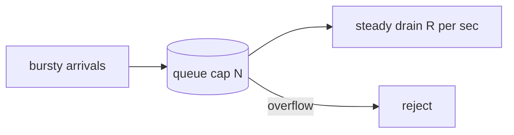

# Leaky Bucket

Leaky bucket is a [[rate-limiting]] algorithm that models the system as a bucket with a hole in the bottom. Requests pour in at whatever rate they arrive and drain out at a fixed rate. If the bucket fills to capacity, further arrivals overflow and are rejected.

The defining property is that the *output* is perfectly smooth. Whatever the arrival pattern, the downstream sees a constant rate.

## How it differs from token bucket

The two are frequently described as equivalent, and for admission decisions the meter variant genuinely is. The difference that matters is what each one shapes.

[[token-bucket]] shapes *permission*: it decides whether an incoming request may proceed, and a burst of allowed requests reaches the downstream all at once. Leaky bucket shapes *departure*: requests are enqueued on arrival and released on a schedule, so the downstream never sees a burst at all.

That makes leaky bucket the right choice when the thing you are protecting genuinely cannot absorb bursts — a legacy system with a fixed connection pool, a third-party API that penalises spikes, a device behind a fixed serial link. Token bucket is right when the downstream can absorb a burst and only needs its long-run average bounded.

## The two variants

**Leaky bucket as a queue** is the description above: real requests wait in a real buffer and are dispatched at a fixed rate. This is traffic shaping, and it is what a job scheduler or an egress worker pool implements.

**Leaky bucket as a meter** keeps no queue. It tracks a counter that leaks at a fixed rate and increments per request, rejecting when the counter would exceed capacity. No request ever waits — this is pure admission control, and it is the mirror image of token bucket. When someone says the two algorithms are the same thing, this is the variant they mean.

Knowing which one is under discussion is most of the value of the term.

## What you give up

The queue variant trades errors for latency, and latency is the sneakier failure. A caller whose request sits in a leaky bucket for four seconds does not know anything is wrong; it just experiences a slow service, and its own timeout and retry logic may fire and add *more* load while the original request is still queued. Rejecting immediately at least tells the truth.

Queued requests also cost memory and held connections, and the queue is a place for stale work to accumulate. A request that has been waiting past the point where its caller gave up is pure waste — you will spend real capacity producing a response nobody is listening for. Any queue variant needs a deadline check at dispatch time, and that is a piece of code people routinely forget to write.

You also give up burst tolerance entirely, which for most public APIs is a downgrade rather than a feature. The bursty-but-legitimate client that [[token-bucket]] is designed to accommodate gets smoothed here whether it needed smoothing or not.
