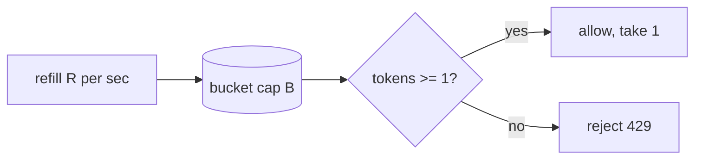

# Token Bucket

Token bucket is a [[rate-limiting]] algorithm that models permission as a bucket of tokens. The bucket holds at most `B` tokens and refills at `R` tokens per second. Each request removes one token, and a request arriving at an empty bucket is rejected. Over any long period the caller is held to `R` requests per second, but a caller who has been idle can spend accumulated tokens all at once — up to `B` of them.

That last property is the whole point. Token bucket permits bursts, and it permits them in proportion to how quiet the caller has recently been.

## How it works

The naive implementation runs a timer that adds tokens on a schedule. Nobody does this, because it means a background thread per limit key and there may be millions of keys.

Instead the refill is computed lazily at read time. Store two values per key — the token count and the timestamp of the last update — and on each request work out how many tokens *would* have accrued since that timestamp:

```
elapsed = now - last_refill
tokens  = min(B, tokens + elapsed * R)
```

If `tokens >= 1`, decrement and allow; otherwise reject. Two fields per key, no timers, and state that is correct whenever you happen to look at it.



The two parameters are independent and mean different things. `R` is the sustained rate you are willing to serve indefinitely. `B` is how much short-term unfairness you will tolerate in exchange for not punishing bursty but well-behaved clients. Setting `B` equal to `R` gives roughly one second of burst headroom; setting `B` to ten times `R` lets a client that has idled for ten seconds fire ten seconds of traffic instantly.

## Why it is usually the right default

Real client traffic is bursty. A mobile app that syncs on foreground, a batch job that wakes hourly, a page that fires six API calls on load — none of these are abusive, and all of them are indistinguishable from abuse under an algorithm that enforces a strict per-instant rate. Token bucket accommodates them without raising the sustained limit, which is the combination you want.

It is also cheap: constant memory per key regardless of how large the limit is, which [[sliding-window-log]] cannot claim.

## What you give up

The burst allowance is a real hole in your capacity protection. If ten thousand clients each hold a full bucket of `B` tokens — because they have all been idle, which is exactly the state after any broad outage recovers — they can collectively fire `10,000 × B` requests in the same instant, far beyond anything the sustained rate would suggest. The limiter is behaving exactly as specified while the service falls over. This is a [[thundering-herd]] in disguise, and it is the standard argument for putting a [[leaky-bucket]] or a global concurrency cap *behind* the per-client token buckets.

You are also tuning two knobs instead of one, and their interaction is not intuitive. Operators reason fluently about "1000 requests per minute" and much less fluently about "16.7 per second with a burst of 300", even though those can describe the same policy. Expect the burst parameter to be misconfigured, usually by being left at whatever the example config said.

Finally, the lazy refill is clock arithmetic. Across distributed instances reading shared state, skew between nodes shows up as tokens being quietly created or destroyed at the margins — small in practice, but it means the algorithm is only as monotonic as your clocks are.
